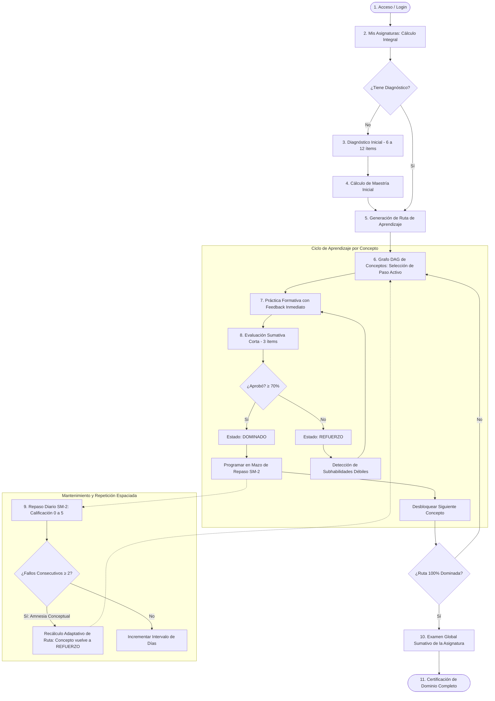

# 🧭 Estado del Proyecto y Flujo de la Aplicación

**Documento:** Guía Funcional, Arquitectura y Estado de Entrega  
**Fecha:** 26 de Octubre, 2026  
**Sistema:** Cognia (Backend API) + FrontPI (Frontend Web)  
**Asignatura Piloto:** Cálculo Integral  

---

## 📊 1. Resumen Ejecutivo del Estado del Sistema

La plataforma se encuentra en un estado **funcional end-to-end (~98% completado)**, con la totalidad de los flujos pedagógicos y técnicos conectados entre el cliente web (React 19) y el servidor de aprendizaje adaptativo (Spring Boot 4 / Java 17).

```mermaid
flowchart LR
    subgraph Frontend [FrontPI - Puerto 8443]
        UI[React 19 + Tailwind CSS v4]
        KaTeX[Renderizador KaTeX]
        Runners[Runners Especializados]
        AuthC[AuthContext + JWT]
        UI --> Runners
        Runners --> KaTeX
        Runners --> AuthC
    end

    subgraph Backend [Cognia API - Puerto 8080]
        Sec[Spring Security + JWT]
        Hex[Arquitectura Hexagonal]
        Engine[Motor Adaptativo & SM-2]
        Sec --> Hex
        Hex --> Engine
    end

    subgraph Storage [Persistencia]
        DB[(PostgreSQL 16)]
    end

    AuthC ===>|HTTP / REST (JSON)| Sec
    Hex ===>|JPA / JDBC| DB
```

### 📌 Tabla Consolidada de Estado por Módulos

| Módulo | Alcance / Tecnología | Estado | Aspectos Clave |
|---|---|:---:|---|
| **Backend Core (`Cognia`)** | Java 17, Spring Boot 4.1.1, Spring Data JPA | ✅ **Completado** | Arquitectura hexagonal pura. Motor de ruta adaptativa, algoritmo de corrección formativa, política de maestría y repetición espaciada SM-2. |
| **Seguridad & CORS** | Spring Security, JJWT (HS256), `CorsConfiguration` | ✅ **Completado** | Autenticación stateless por JWT (`/auth/login`, `/register`, `/me`), inyección `@CurrentStudent UUID studentId` y filtro de compatibilidad para dev/test. |
| **DevOps & Despliegue** | Docker multi-stage, `docker-compose.yml`, CI | ✅ **Completado** | Dockerfile optimizado con usuario sin privilegios, Postgres 16 con healthchecks y workflow de GitHub Actions CI. |
| **Frontend Web (`FrontPI`)** | React 19, TypeScript 5.7, Vite 8, Tailwind v4 | ✅ **Completado** | Estética oscura editorial ("Itinera"), grafo DAG interactivo con SVG y curvas de Bézier, paleta semántica (`sage`, `brass`, `clay`). |
| **Conexión de Endpoints** | Capa HTTP centralizada (`src/api/`) | ✅ **Completado** | Conexión real en diagnóstico, asignaturas, ruta de aprendizaje, prácticas, evaluaciones cortas, repasos SM-2 y examen global. |
| **Renderizado Matemático** | KaTeX (`MathText.tsx`) | ✅ **Completado** | Interpretación de fórmulas LaTeX (`$`, `$$`, `\\[...\\]`) para todas las actividades de cálculo. |

---

## 🔄 2. Flujo Integral de la Aplicación (User Journey)

El flujo de Cognia no es un curso lineal tradicional; es un **ciclo de aprendizaje adaptativo basado en grafos de conocimiento y retención a largo plazo**.



---

### Paso a Paso Detallado del Flujo

#### 1. Autenticación y Perfil de Usuario
* El alumno accede mediante correo y contraseña ([src/App.tsx](file:///c:/Users/Alejandro/Documents/ProyectoIntegrador1/FrontPI/src/App.tsx)).
* Puede registrarse como nuevo usuario o utilizar el botón de **cuenta de prueba** (`30000000-0000-0000-0000-000000000001`).
* El backend valida credenciales con BCrypt y emite un token JWT con vigencia de 24 horas.

#### 2. Selección de Asignatura ("Mis Asignaturas")
* Pantalla: [Subjects](file:///c:/Users/Alejandro/Documents/ProyectoIntegrador1/FrontPI/src/screens.tsx#L181).
* Consume `GET /api/v1/subjects` para listar las materias disponibles.
* Al seleccionar **Cálculo Integral**, el sistema verifica si el estudiante ya cuenta con un perfil diagnóstico en la base de datos (`GET /subjects/{id}/diagnostic-profile`).

#### 3. Diagnóstico Inicial Adaptativo
* Componentes: [DiagIntro](file:///c:/Users/Alejandro/Documents/ProyectoIntegrador1/FrontPI/src/screens.tsx#L286) y [DiagnosticRunner](file:///c:/Users/Alejandro/Documents/ProyectoIntegrador1/FrontPI/src/DiagnosticRunner.tsx).
* Inicia sesión con `POST /subjects/{id}/diagnostic-sessions`.
* El alumno resuelve una serie de actividades representativas de los conceptos iniciales y sus prerrequisitos (ej. antiderivadas, reglas básicas, sumas de Riemann).
* Por cada ítem, `DiagnosticRunner` envía la respuesta y el tiempo de respuesta en segundos con `POST /diagnostic-sessions/{id}/answers`.
* Al finalizar (`POST /.../finish`), el backend ejecuta `RuleBasedMasteryPolicy`, ponderando el puntaje según dificultad (Nivel 1: $\times 1.0$, Nivel 2: $\times 1.5$, Nivel 3: $\times 2.0$).
* **Resultado:** Se genera el perfil de maestría inicial en `historial_maestria` y se muestra el resumen en `DiagSummary`.

#### 4. Grafo de Conocimiento y Generación de Ruta
* Componentes: [KnowledgeGraph](file:///c:/Users/Alejandro/Documents/ProyectoIntegrador1/FrontPI/src/Graph.tsx) y [PathScreen](file:///c:/Users/Alejandro/Documents/ProyectoIntegrador1/FrontPI/src/screens.tsx#L369).
* El backend ejecuta `LearningPathGenerator`, realizando una **ordenación topológica** sobre el DAG (Grafo Acíclico Dirigido) de prerrequisitos de la asignatura.
* Los conceptos que el alumno demostró dominar ($\ge 80\%$) pasan a estado `DOMINADO` inmediatamente.
* El primer concepto no dominado cuyos prerrequisitos estén cubiertos se establece en `EN_PROGRESO` (`current`).
* Los conceptos posteriores quedan en `BLOQUEADO`.

#### 5. Ciclo de Aprendizaje de un Concepto

##### A. Práctica Formativa
* Componente: [PracticeRunner](file:///c:/Users/Alejandro/Documents/ProyectoIntegrador1/FrontPI/src/PracticeRunner.tsx).
* Carga actividades con `GET /concepts/{id}/practice-activities`.
* Modo formativo sin penalización sumativa: cada respuesta registra un intento en `intento_actividad` mediante `POST /activities/{id}/practice-attempts`.
* El servidor devuelve retroalimentación inmediata, explicación detallada y si la respuesta fue correcta o incorrecta.

##### B. Evaluación Sumativa Corta
* Componentes: [EvalIntro](file:///c:/Users/Alejandro/Documents/ProyectoIntegrador1/FrontPI/src/screens2.tsx#L232) y [EvalRunner](file:///c:/Users/Alejandro/Documents/ProyectoIntegrador1/FrontPI/src/EvalRunner.tsx).
* Al finalizar la práctica, se desbloquea la evaluación corta del paso de ruta (`POST /subjects/{id}/path-steps/{stepId}/short-evaluations`).
* Consiste en **3 ítems sumativos calibrados**, sin pistas intermedias.
* Al enviar la última respuesta y finalizar con `POST /short-evaluations/{id}/finish`:
  * **Si aprueba ($\ge 70\%$):** El paso de ruta pasa a `DOMINADO` (color `sage`). Se desbloquea el siguiente paso en la ruta y se agenda la primera tarjeta en el mazo de repaso.
  * **Si reprueba ($< 70\%$):** El paso de ruta pasa a `REFUERZO` (color `clay`). El sistema desglosa las subhabilidades evaluadas e identifica los puntos débiles para que el alumno refuerce antes de un nuevo intento.

#### 6. Repetición Espaciada (SM-2) y Detección de Amnesia Conceptual
* Componentes: [ReviewList](file:///c:/Users/Alejandro/Documents/ProyectoIntegrador1/FrontPI/src/screens2.tsx#L295) y [ReviewRunner](file:///c:/Users/Alejandro/Documents/ProyectoIntegrador1/FrontPI/src/ReviewRunner.tsx).
* Los conceptos dominados no se abandonan; se programan tarjetas de repaso según el algoritmo SuperMemo-2 (`GET /subjects/{id}/reviews/due`).
* En la sesión de repaso (`POST /review-sessions`), el alumno califica su facilidad de recuerdo en una escala de **0 a 5**:
  * $0 - 2$: Fallo en la retención.
  * $3 - 5$: Retención exitosa (el intervalo de días se multiplica por el factor de facilidad $EF \ge 1.3$).
* **Regla Adaptativa de Amnesia Conceptual:** Si el estudiante comete **2 fallos consecutivos** en una tarjeta dominada, el backend activa la detección de amnesia:
  * Invalida la ruta actual marcándola como `RECALCULADA`.
  * Genera una nueva versión de la ruta (`version = version + 1`).
  * Reabre el concepto olvidado cambiándolo de `DOMINADO` a `REFUERZO`.

#### 7. Examen Global Sumativo
* Componentes: [FinalReady](file:///c:/Users/Alejandro/Documents/ProyectoIntegrador1/FrontPI/src/screens2.tsx#L476) y [GlobalExamRunner](file:///c:/Users/Alejandro/Documents/ProyectoIntegrador1/FrontPI/src/GlobalExamRunner.tsx).
* Se habilita únicamente cuando **todos los conceptos del currículo alcanzan el estado `DOMINADO`**.
* Inicia examen con `POST /subjects/{id}/global-exams`.
* Evalúa de forma transversal con preguntas mixtas de todos los conceptos de Cálculo Integral.
* Al finalizar (`POST /global-exams/{id}/finish`), genera la nota final oficial del curso y el desglose de conceptos fuertes y débiles.

---

## ⚙️ 3. Puesta en Marcha y Verificación

### Prerrequisitos
* Node.js $\ge 18$ y npm.
* Docker Desktop (opcional para levantar backend en contenedor) o JDK 17.

### Pasos para Ejecutar Localmente

#### 1. Iniciar el Backend (Docker)
```powershell
cd c:\Users\Alejandro\Documents\ProyectoIntegrador1\Cognia

# Asegurar que .env.docker tenga la clave JWT y contraseña de postgres
docker compose --env-file .env.docker config
docker compose --env-file .env.docker up -d --build
```
> La API quedará disponible en `http://localhost:8080/api/v1`  
> Documentación Swagger UI en `http://localhost:8080/swagger-ui.html`

#### 2. Iniciar el Frontend (Vite)
```powershell
cd c:\Users\Alejandro\Documents\ProyectoIntegrador1\FrontPI

npm run dev
```
> El cliente web abrirá en `http://localhost:8443/`

---

## 📈 4. Estado de Cumplimiento de Criterios

- [x] **Autenticación formal JWT:** Tokens emitidos, almacenados en `localStorage` y validados en cabeceras `Authorization: Bearer`.
- [x] **Currículo dinámico:** Conceptos y grafo DAG cargados desde la base de datos relacional.
- [x] **Diagnóstico persistente:** Historial de maestría guardado en base de datos.
- [x] **Ruta adaptativa e iterativa:** Versionado de ruta ante fallos y reordenamiento topológico.
- [x] **Práctica formativa vs Evaluación sumativa:** Separación nítida entre aprendizaje con pistas y calificación formal.
- [x] **Algoritmo SM-2:** Tarjetas espaciadas con detección de amnesia conceptual.
- [x] **KaTeX integrado:** Todas las fórmulas de cálculo se visualizan con tipografía matemática estándar.
- [x] **Cero errores de compilación:** TypeScript `tsc --noEmit` en verde sin advertencias.
