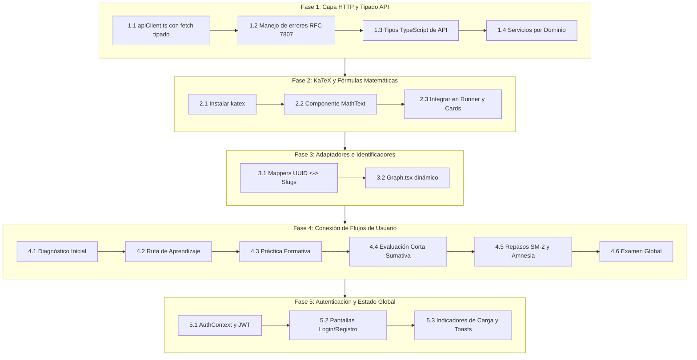

# 🎨 Plan Maestro de Implementación - Frontend (FrontPI)

**Documento:** Guía de Arquitectura, Conexión e Implementación del Cliente Web  
**Fecha:** 26 de Octubre, 2026  
**Módulo:** FrontPI (`/FrontPI`)  
**Stack:** React 19, TypeScript 5.7, Vite 8, Tailwind CSS v4, Lucide React  
**Backend de referencia:** Cognia API (`http://localhost:8080/api/v1`)  
**Objetivo:** Conectar el prototipo interactivo maquetado en React 19 con la API REST hexagonal de Cognia, reemplazando el estado simulado en memoria por una arquitectura cliente robusta, tipada, con renderizado matemático KaTeX y manejo de errores RFC 7807.

## 📊 Estado de Implementación

| Fase | Descripción | Estado | Completado |
|:----:|:------------|:------:|:----------:|
| 1 | Capa HTTP y Tipado API | ✅ Completada | 26/10/2026 |
| 2 | KaTeX y Fórmulas Matemáticas | ⏳ Pendiente | — |
| 3 | Adaptadores e Identificadores | ⏳ Pendiente | — |
| 4 | Conexión de Flujos de Usuario | ⏳ Pendiente | — |
| 5 | Autenticación y Estado Global | ⏳ Pendiente | — |

---

## 🧭 1. Diagnóstico del Punto de Partida

### Lo que ya existe y funciona excelentemente:
* **Diseño y Estética Premium:** Interfaz oscura moderna con diseño editorial, tipografías mono/sans, sistema de tokens en [src/index.css](src/index.css) y paleta semántica (`sage` para dominado, `brass` para activo/en curso, `clay` para refuerzo).
* **Componentes UI Reutilizables:** Botones con tonos ([src/ui.tsx](src/ui.tsx)), anillos de maestría SVG (`Ring`), barras de avance (`Bar`), badges y modales.
* **Grafo de Conocimiento SVG:** [src/Graph.tsx](src/Graph.tsx) renderiza un DAG con curvas de Bézier entre conceptos conectados por prerrequisitos.
* **Ejecutor de Evaluaciones (`Runner.tsx`):** Componente interactivo para presentar preguntas con opciones radiales, temporizador y envío de respuestas.
* **Pantallas Maquetadas:** Cobertura de todos los flujos de usuario en [src/screens.tsx](src/screens.tsx) y [src/screens2.tsx](src/screens2.tsx).

### La Deuda Técnica a Resolver:
* **Estado 100% Mock en Memoria:** [src/state.ts](src/state.ts) y [src/data.ts](src/data.ts) calculan la maestría, los resultados y las transiciones mediante funciones locales sincrónicas (`finishDiag`, `finishEval`), sin conexión al servidor.
* **Identificadores Incompatibles:** El prototipo usa slugs (`"prim"`, `"reglas"`), mientras que Cognia opera con `UUID` v4 (`10000000-...-0001`).
* **Sin Renderizado Matemático:** Fórmulas como `∫ (2x³ − 5) dx` se renderizan como texto plano sin KaTeX.
* **Ausencia de Capa HTTP:** No hay cliente `fetch`, manejo de cabeceras (`Authorization: Bearer` / `X-Student-Id`), ni captura de errores RFC 7807 (`ProblemDetail`).

---

## 🗺️ 2. Hoja de Ruta de Implementación por Fases



---

## 🛠️ 3. Especificación Técnica Detallada por Fases

### 🔹 Fase 1: Capa de Comunicación HTTP y Tipado de API

1. **Variables de Entorno (`.env.local` y `.env.example`):**
   ```bash
   VITE_API_URL=http://localhost:8080/api/v1
   # Estudiante por defecto para modo de pruebas (UUID de desarrollo en Cognia)
   VITE_DEFAULT_STUDENT_ID=30000000-0000-0000-0000-000000000001
   ```

2. **Cliente API Centralizado (`src/api/client.ts`):**
   * Crear cliente `apiFetch<T>` que:
     * Inyecte la URL base (`VITE_API_URL`).
     * Inyecte `Authorization: Bearer <token>` (si existe token JWT en `localStorage`) o `X-Student-Id: <uuid>` (como fallback de desarrollo).
     * Envíe `Content-Type: application/json`.
     * Intercepte respuestas con `status >= 400` y desempaquete el formato RFC 7807 (`ProblemDetail`):
       ```typescript
       export interface ApiError {
         type?: string;
         title: string;
         status: number;
         detail: string;
         instance?: string;
         invalidParams?: { name: string; reason: string }[];
       }
       ```

3. **Tipos de la API (`src/api/types.ts`):**
   * Definir interfaces TypeScript idénticas a los DTOs de Spring Boot:
     * `SubjectDto`: `{ id: string; codigo: string; nombre: string; descripcion: string }`
     * `ConceptDto`: `{ id: string; codigo: string; nombre: string; nivel: number; ordenSugerido: number }`
     * `DiagnosticSessionDto`: `{ id: string; subjectId: string; estado: string; activities: ActivityDto[] }`
     * `LearningPathDto`: `{ id: string; version: number; estado: string; steps: PathStepDto[] }`
     * `PathStepDto`: `{ id: string; conceptId: string; ordenSugerido: number; estado: "BLOQUEADO" | "DISPONIBLE" | "EN_PROGRESO" | "REFUERZO" | "DOMINADO" }`
     * `ActivityDto`: `{ id: string; conceptId: string; tipo: "SELECCION_MULTIPLE" | "RESPUESTA_CORTA"; dificultad: number; enunciado: string; options?: { id: string; text: string }[] }`
     * `ReviewQueueItemDto`: `{ progressId: string; conceptId: string; card: { id: string; front: string; back: string } }`
     * `GlobalExamDto`: `{ id: string; estado: string; activities: ActivityDto[] }`

4. **Módulos de Servicios API (`src/api/services/`):**
   * `curriculumApi.ts`: `getSubjects()`, `getConcepts(subjectId)`, `getPrerequisites(conceptId)`.
   * `diagnosticApi.ts`: `startDiagnostic(subjectId)`, `sendAnswer(sessionId, activityId, payload)`, `finishDiagnostic(sessionId)`, `getProfile(subjectId)`.
   * `learningPathApi.ts`: `generatePath(subjectId)`, `getActivePath(subjectId)`, `getNextStep(subjectId)`.
   * `practiceApi.ts`: `getPracticeActivities(conceptId, difficulty?)`, `sendPracticeAttempt(activityId, payload)`.
   * `evaluationApi.ts`: `startShortEval(subjectId, stepId)`, `sendEvalAnswer(sessionId, activityId, payload)`, `finishShortEval(sessionId)`.
   * `reviewApi.ts`: `getDueReviews(subjectId)`, `startReviewSession(subjectId)`, `submitGrade(sessionId, payload)`, `finishReviewSession(sessionId)`.
   * `globalExamApi.ts`: `startGlobalExam(subjectId)`, `sendExamAnswer(examId, activityId, payload)`, `finishGlobalExam(examId)`.

---

### 🔹 Fase 2: Soporte para Expresiones Matemáticas con KaTeX

Las preguntas formativas y sumativas de Cálculo Integral contienen integrales, límites y fracciones que deben visualizarse limpiamente.

1. **Instalación de Dependencias:**
   ```bash
   pnpm add katex
   pnpm add -D @types/katex
   ```
2. **Importar CSS de KaTeX:**
   En `src/index.css`:
   ```css
   @import "katex/dist/katex.min.css";
   ```
3. **Crear Componente Reutilizable (`src/components/MathText.tsx`):**
   * Parser ligero que detecte bloques delimitados por `$...$` (en línea) o `$$...$$` (bloque centrado), renderizándolos con `katex.renderToString` con `throwOnError: false`.
   * Integrar `<MathText />` en `Runner.tsx` (enunciados y opciones) y en las flashcards de repaso SM-2 (anverso y reverso).

---

### 🔹 Fase 3: Reconciliación del Grafo y Adaptadores de Datos

Actualmente, [src/Graph.tsx](src/Graph.tsx) calcula la posición geométrica (`col`, `row`) basándose en una constante estática de 12 conceptos.

1. **Hacer Dinámico `KnowledgeGraph`:**
   * Recibir como props:
     * `concepts: ConceptDto[]` (cargados desde la API).
     * `prerequisites: PrerequisiteDto[]` (aristas devueltas por la API).
     * `pathSteps: PathStepDto[]` (estados de la ruta activa del estudiante).
   * Asignar coordenadas `(col, row)` calculando los niveles topológicos o mapeando el campo `nivel` y `ordenSugerido` provisto por el backend.
2. **Mapeo de Estados de Paso a Estilos Visuales:**
   * `BLOQUEADO` $\rightarrow$ Candado, tono `muted` (borde sutil, opacidad 75%).
   * `DISPONIBLE` $\rightarrow$ Tono `brass` halo (nodo interactivo, listo para comenzar).
   * `EN_PROGRESO` $\rightarrow$ Tono `brass` pulsante o con barra de avance parcial.
   * `REFUERZO` $\rightarrow$ Tono `clay` (borde discontinuo color terracota/ámbar, etiqueta *"Requiere refuerzo"*).
   * `DOMINADO` $\rightarrow$ Tono `sage` (borde verde jade, check de completado).

---

### 🔹 Fase 4: Conexión de Flujos de Usuario (Slices UI)

Sustituir de forma incremental la mutación local de `App.tsx` por llamadas asíncronas con gestión de `loading` y `error`:

#### 1. Flujo de Diagnóstico Inicial
* **Vista `Subjects` / `Subject`:**
  * Al hacer clic en *"Cálculo Integral"*, consultar `GET /api/v1/subjects/{id}/learning-path`.
  * Si la ruta ya existe, navegar directo a `path`.
  * Si retorna `404` (no tiene ruta), ofrecer el botón *"Comenzar diagnóstico inicial"*.
* **Vista `diag` (`Runner.tsx`):**
  * Invocar `diagnosticApi.startDiagnostic(subjectId)`. Cargar las preguntas devueltas por el backend.
  * Al responder cada ítem: enviar `{ optionId, seconds }` a `POST .../answers/{activityId}`.
  * Al terminar: invocar `POST .../finish`.
  * Consultar `GET .../profile` para mostrar el resumen en `DiagSummary` con el porcentaje inicial estimado por concepto.

#### 2. Flujo de Ruta y Práctica Formativa
* **Generación de Ruta:**
  * Al salir del diagnóstico, llamar a `learningPathApi.generatePath(subjectId)` y mostrar la animación de generación de ruta (`PathNew`).
* **Práctica Formativa (`ActivityScreen`):**
  * Al seleccionar un concepto disponible o en refuerzo, consultar `GET /api/v1/concepts/{conceptId}/practice-activities`.
  * Al enviar una respuesta: `POST /api/v1/activities/{activityId}/practice-attempts`.
  * Mostrar el veredicto del backend (`correct: true/false`, retroalimentación formativa y explicación pedagógica).

#### 3. Flujo de Evaluación Corta Sumativa
* **Inicio:** `POST /api/v1/subjects/{id}/path-steps/{stepId}/short-evaluations`.
* **Ejecución:** Cargar los 3 ítems en `QuestionRunner` en modo evaluación (`sin pistas`).
* **Cierre:** `POST /api/v1/short-evaluations/{sessionId}/finish`.
* **Pantalla de Resultado (`EvalResultScreen`):**
  * Mostrar puntaje obtenido y umbral (70%).
  * Si aprobó: celebrar avance a `DOMINADO` y actualizar el nodo en el grafo.
  * Si reprobó: indicar que el concepto permanece en `EN_PROGRESO` o pasa a `REFUERZO` y recomendar actividades formativas adicionales.

#### 4. Flujo de Repasos Espaciados SM-2
* **Pantalla `ReviewList`:**
  * Consultar `GET /api/v1/subjects/{id}/reviews/due`.
  * Si la lista está vacía, mostrar estado vacío (*"¡Estás al día! No hay tarjetas vencidas hoy"*).
* **Pantalla `ReviewScreen` (Flashcard interactiva):**
  * Mostrar anverso (pregunta/ejercicio) con `<MathText />`.
  * Botón *"Mostrar respuesta"* gira la tarjeta revelando el reverso y la explicación.
  * Selector de calificación SM-2 (0 a 5):
    * `0-1`: *"No lo recordaba"* (Rojo)
    * `2-3`: *"Recordé con dificultad"* (Ámbar)
    * `4-5`: *"Recordé fácilmente"* (Verde)
  * Enviar `POST /api/v1/review-sessions/{id}/grades` con `{ progressId, grade, seconds }`.
* **Cierre y Detección de Amnesia Conceptual:**
  * Finalizar con `POST /api/v1/review-sessions/{id}/finish`.
  * **Alerta Crítica de Amnesia:** Si el backend detectó 2 fallos consecutivos y recalculó la ruta, el response del review indicará la reapertura. El frontend debe mostrar un modal destacando:
    > *"Hemos detectado dificultades en este concepto durante el repaso. Tu ruta se ha adaptado y ha reabierto el concepto en estado de REFUERZO para consolidarlo."*
  * Refrescar inmediatamente el estado de la ruta en la barra de navegación.

#### 5. Flujo de Examen Global
* **Acceso:** Solo disponible si la ruta de mayor versión está en estado `COMPLETADA` (todos los pasos dominados). Si no, mostrar candado explicativo.
* **Ciclo:** `POST /global-exams` $\rightarrow$ responder ítems $\rightarrow$ `POST /finish`.
* **Resultado (`GlobalResultScreen`):** Desglose de maestría final acumulada por cada uno de los 12 conceptos.

---

### 🔹 Fase 5: Autenticación, Estado Global y Resiliencia

1. **Contexto de Autenticación (`src/context/AuthContext.tsx`):**
   * Gestionar estado: `user`, `token`, `isAuthenticated`, `isLoading`.
   * Métodos: `login(email, password)`, `register(email, password, fullName)`, `logout()`.
   * Almacenar token en `localStorage` y propagarlo automáticamente a `apiFetch`.
2. **Pantallas de Acceso:**
   * Modal o pantalla simple de Login / Registro conectada a `/api/v1/auth/**`.
   * Modo *"Desarrollo rápido"*: selector de perfiles de prueba para alternar de estudiante sin tener que desloguearse.
3. **Manejo Visual de Errores y Estados de Carga:**
   * Crear componente `<LoadingOverlay />` y skeletons para el grafo mientras resuelve la promesa.
   * Componente de notificación Toast para atrapar errores 400, 404, 409 y mostrar el mensaje amigable provisto por el backend en `error.detail`.

---

## ⚠️ 4. Matriz de Riesgos y Soluciones para el Frontend

| # | Riesgo Técnico | Impacto | Solución Frontend |
| :-: | :--- | :---: | :--- |
| **R1** | **Bloqueo por CORS al llamar a localhost:8080** | 🔴 Alto | Configurar `server.proxy` en `vite.config.ts`: redirigir `/api` a `http://localhost:8080`. Así el navegador envía peticiones al mismo puerto de Vite. |
| **R2** | **Desfase de IDs de Conceptos (UUIDs vs Slugs)** | 🔴 Alto | Usar siempre `concept.id` (UUID) para peticiones a la API. Usar `concept.codigo` (ej. "C0.1") para labels y matching en pantalla. |
| **R3** | **Error 409 Conflict al entrar al Examen Global** | 🟡 Medio | Consultar siempre el estado de la ruta activa (`GET /learning-path`). Si `estado !== 'COMPLETADA'`, deshabilitar el botón y mostrar tooltip explicativo. |
| **R4** | **Renderizado roto de fórmulas con caracteres especiales** | 🟡 Medio | KaTeX debe configurarse con `throwOnError: false` para que si un string contiene fórmulas no estándar, renderice el texto crudo sin romper la aplicación. |
| **R5** | **Pérdida de respuestas en evaluaciones si se recarga la página** | 🟡 Medio | Guardar en `sessionStorage` el `sessionId` y las respuestas intermedias de la evaluación o diagnóstico en curso para restaurarlas en caso de refresh accidental. |

---

## 🏁 5. Criterios de Aceptación (Definition of Done de FrontPI)

1. [ ] Cero dependencias de datos fijos en `state.ts` para los flujos de estudiante.
2. [ ] El diagnóstico, la ruta, la práctica, la evaluación corta, el repaso SM-2 y el examen global leen y escriben en la base de datos a través de la API.
3. [ ] Todas las fórmulas matemáticas en enunciados, opciones y flashcards se renderizan con KaTeX.
4. [ ] El grafo en `Graph.tsx` refleja en tiempo real los estados `BLOQUEADO`, `DISPONIBLE`, `DOMINADO` y `REFUERZO`.
5. [ ] El build de producción `pnpm build` ejecuta sin advertencias ni errores de TypeScript.
